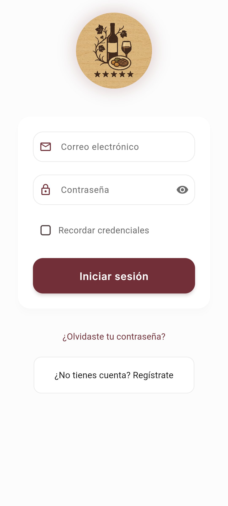
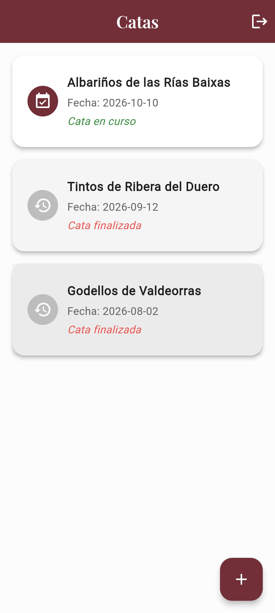
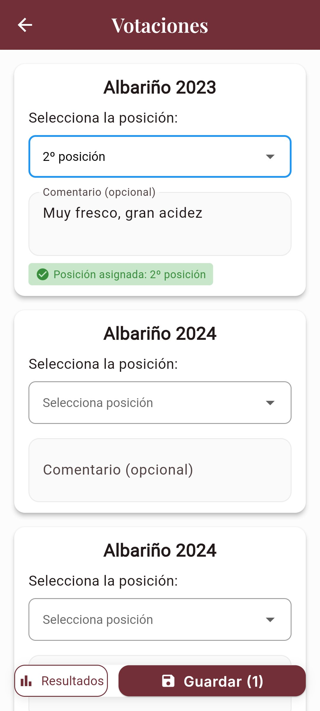
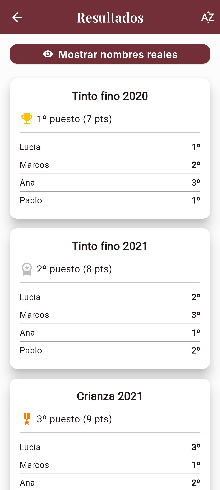
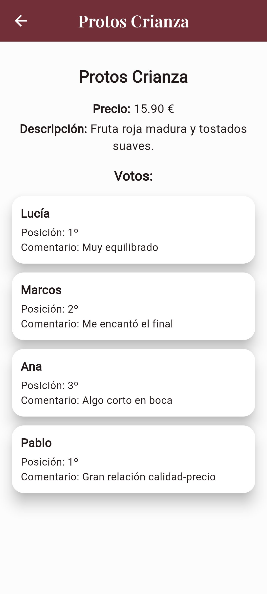
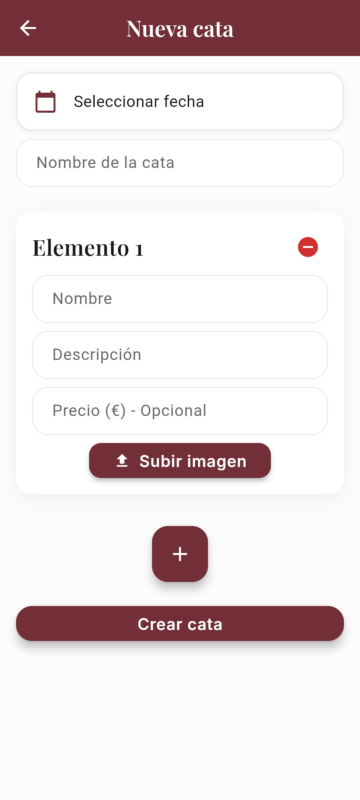

# Cata — Blind Wine Tasting App

**Cata** is a Flutter app for organising blind wine tastings with friends. The organiser creates a tasting with the bottles to taste; participants see only an alias for each wine, rank them and leave comments; when the tasting is closed everyone can see the aggregated ranking and reveal the real labels.

Built with Flutter + Firebase (Auth, Cloud Firestore, Storage) and deployed to Android, iOS and the web (Firebase Hosting).

## Features

- **Email/password accounts** with sign-up, password reset and a "remember credentials" option.
- **Tastings list** in real time, split between tastings in progress and finished ones.
- **Create and edit tastings**: date, list of wines with real name, blind alias, description, price and an optional photo uploaded to Firebase Storage.
- **Blind voting**: each participant assigns a unique position (1st, 2nd, …) to every wine plus an optional comment. Votes are saved in a single batch.
- **Open / close tastings**: the organiser decides when voting ends; closed tastings become read-only.
- **Results**: ranking by total points (sum of positions — lower is better), medals for the podium, sort by ranking or name, and a toggle to reveal the real wine names.
- **Wine detail**: price, description and every participant's position and comment.
- **Backwards compatible** with the legacy 1–10 scoring system used by older tastings.

## Screenshots

| Login | Tastings | Blind voting |
|:---:|:---:|:---:|
|  |  |  |

| Results | Wine detail | New tasting |
|:---:|:---:|:---:|
|  |  |  |

## Tech stack

- **Flutter / Dart** with Material 3 and a custom "Bordeaux" theme (`lib/utils/styles.dart`, Google Fonts).
- **State management**: `provider` (`AuthService`, `FirestoreService` as `ChangeNotifier`s).
- **Firebase**: Authentication, Cloud Firestore (`catas/{id}/elementos/{id}/votos/{uid}`, `usuarios/{uid}`), Storage for wine photos, Hosting for the web build.
- `image_picker`, `uuid`, `shared_preferences`.

## Project structure

```
lib/
  main.dart                 # Firebase init, theme, auth gate
  models/                   # Cata, ElementoCata, Voto
  services/                 # AuthService, FirestoreService (all Firestore access)
  screens/                  # login, home, create_cata, votacion_detail, vote_form, resultados, resultados_detail
  utils/styles.dart         # colours, spacing, text styles
```

## Getting started

```bash
flutter pub get
flutter run            # mobile
flutter run -d chrome  # web
```

The app expects a Firebase project configured with FlutterFire (`lib/firebase_options.dart`). Firestore and Storage rules live in `firestore.rules` and `storage.rules`.

## Deploying the web version

See [DEPLOY_WEB.md](DEPLOY_WEB.md), or use `deploy_firebase.bat` / `deploy_firebase.sh` (builds `build/web` and runs `firebase deploy --only hosting`).
